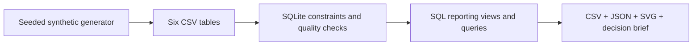

# Retail Analytics Lab

**SQL · Python · SQLite · Conversion · Revenue · Cohort retention**

A reproducible analytics case study: turn six related CSV tables into decision-ready metrics, a dashboard and a short business report.

> Portfolio lab using explicitly synthetic data. No real customers, commercial outcomes or employment claims.


**[Read the findings](reports/findings.md)** · **[Explore the SQL](sql/)** · **[Metric definitions](docs/metrics.md)**

## Business questions

- Which channels bring purchasing visits, and which bring revenue?
- What changes between July and September after accounting for cancellations and refunds?
- Which product categories deserve a closer refund review?
- How many customers purchase again after their first observed purchase?

## Run locally

Python 3.10+ with the standard library; no package installation, account or API key needed.

```bash
python3 src/generate_data.py
python3 src/analyze.py
python3 -m unittest discover -s tests -v
```

The generator uses seed `42`. Analysis loads an in-memory SQLite database and regenerates the committed report, chart, quality results and CSV tables in `reports/`.

## What this demonstrates

| Work | Evidence |
|---|---|
| Relational modeling and constraints | [Six-table schema and reporting views](sql/schema.sql) |
| CTEs, joins, conditional denominators | [Channel conversion](sql/02_channels.sql) |
| Window functions | [Month-over-month revenue with LAG](sql/03_monthly.sql) |
| Cohort analysis | [Observed first-purchase cohorts](sql/04_cohorts.sql) |
| Data quality and repeatable reporting | [Analysis pipeline](src/analyze.py) |
| Metric correctness | [Tests for duplicates, refunds, cancellations and cohort boundaries](tests/test_analytics.py) |
| Analytical communication | [Findings, caveats and next decisions](reports/findings.md) |



## Important choices

**Conversion means unique purchasing sessions / all sessions.** One session can contain multiple orders; orders/visits would answer a different question.

**Refunds are aggregated before joins.** Multiple refund transactions must not duplicate the original line value. Money stays in integer cents until presentation.

**Future retention is unobserved.** The cohort table includes zero activity in observed months, while omitting months after the dataset ends.

## Scope

Fictional EUR retail data from July 1 through September 30, 2026. The generator deliberately gives email a recurring audience, Electronics a higher refund rate and paid search a September conversion decline. Findings are descriptive exercises, not causal evidence. Marketing spend, profit, anonymous visitors, tax and refund timestamps are absent.

See [the walkthrough](docs/walkthrough.md) for how to inspect and extend the project. Created with AI assistance; code and assumptions are available for review.
