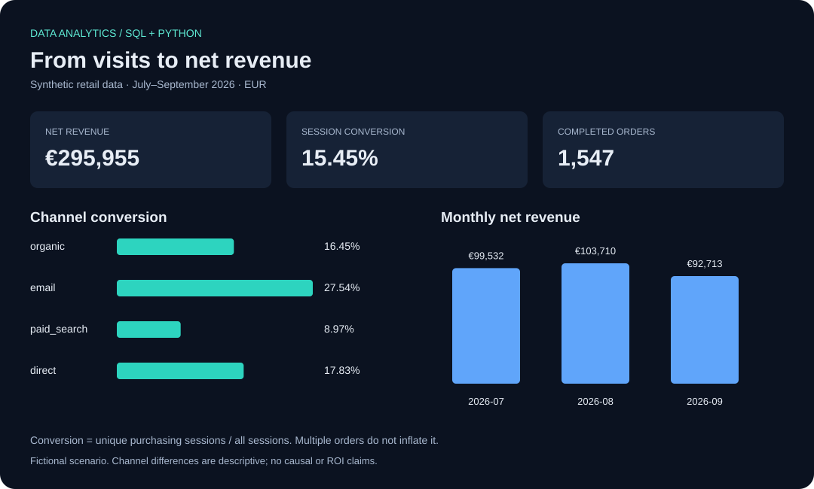

# Retail decision brief

> Reproducible synthetic scenario. These are calculated lab results, not a real company's performance.

## Question
Which channels convert visits into purchases, how does net revenue change, and where should an analyst investigate next?

## Measured results
- 9,300 sessions; 1,437 purchasing sessions; 1,547 completed orders.
- Purchasing-session conversion: **15.45%**.
- Net item revenue after refunds: **€295,955.00**.
- Net average completed-order value: **€191.31**.
- **email** has the highest observed conversion (27.54%).
- **Electronics** has the highest refund-value share (9.72% of category gross revenue).

## Interpretation and next decisions
1. Investigate channel conversion by new/returning customer and campaign before changing budget. Email samples a smaller recurring audience in the generator; higher conversion is not proof of better acquisition.
2. Inspect Electronics refund reasons and product-level patterns. The sample intentionally assigns a higher refund probability to this category; no causal product-quality conclusion follows.
3. Use the monthly table to separate traffic from conversion and revenue changes. Paid-search purchase probability is deliberately reduced in September. Treat this as an investigation exercise, not a discovered market trend.
4. Request marketing spend, margin, campaign assignment and refund timestamps before estimating ROI, profit or cash flow. None are present here.

## Definitions and caveats
- Conversion counts distinct purchasing sessions, not orders divided by visits.
- Revenue excludes cancelled orders and aggregates refunds before joining to avoid duplicated revenue.
- Refunds are attributed back to the purchase period. There are no refund dates, taxes, shipping or discounts.
- Cohorts use first purchase observed in this three-month sample; earlier lifetime purchases are unknown. Future months are not presented as zero retention.
- The identified visitors in this simplified dataset are not a realistic model of anonymous web traffic.

## Evidence
[SQL](../sql/) · [Metric dictionary](../docs/metrics.md) · [Quality checks](quality.json) · [All result tables](summary.json)
